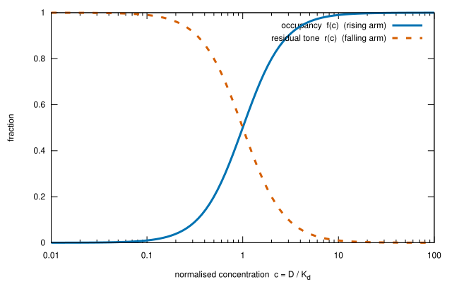
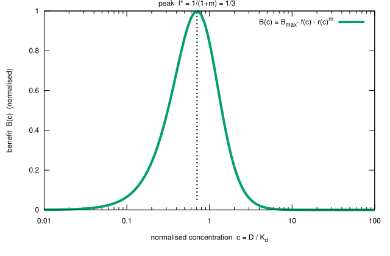

Você tentou LDN a 4 mg por um período prolongado. Sem benefício. Você considera se deve tentar uma dose menor — 1 mg, por exemplo — e surge um raciocínio: se 4 mg não fez nada, 1 mg também não fará nada. O maior contém o menor.

É o raciocínio comum de que um resultado maior deve conter um menor — aplicado à farmacologia. Soa razoável. No entanto, isso está errado para o LDN.

Este artigo explica por que — não atribuindo o erro a ninguém, mas mostrando o que essa inferência assume silenciosamente e por que essa suposição não se aplica quando um medicamento atinge múltiplos alvos em diferentes concentrações.

---

## A resposta curta

Todo o argumento se encaixa num parágrafo e uma tabela. A prova detalhada — separando o que é ciência estabelecida do que é um modelo proposto — segue depois.

O benefício da LDN em dose baixa depende da **bloqueio parcial** do seu recetor: a célula ainda precisa sentir algum sinal residual para montar sua resposta anti-inflamatória compensatória. Se um recetor está bloqueado parcialmente ou completamente é determinado pela concentração do medicamento em relação à sensibilidade do recetor — a razão $c = D/K_d$, dose dividida pela constante de dissociação do recetor. Aumente a dose e $c$ aumenta; a fração $f$ de recetores bloqueados sobe para 100%. A 1 mg, o recetor microglial TLR4 está na zona de bloqueio parcial e o mecanismo de benefício funciona. A 4 mg, o mesmo recetor é bloqueado quase completamente, o sinal residual desaparece e **o mecanismo da 1 mg é desligado — não amplificado.** Enquanto isso, 4 mg ativa um alvo diferente (TRPM3) que a 1 mg nunca alcança. Portanto, um valor nulo a 4 mg testou o mecanismo da 4 mg. Não testou o mecanismo da 1 mg — esse mecanismo não estava a funcionar durante o teste de 4 mg.

Os números tornam isso concreto. A coluna de ocupação utiliza a equação padrão de Hill $f = c^2/(1+c^2)$ (farmacologia estabelecida); a coluna de benefício utiliza o modelo simples $B \propto f(1-f)^2$ proposto na Parte B deste artigo (uma hipótese). As escolhas dos parâmetros são ilustrativas e não medidas: $K_d = 1$ mg, o coeficiente de Hill $n = 2$ e o expoente de inclinação $m = 2$ (o modelo geral na Parte B deixa $n$ e $m$ livres):

| Dose | $c = D/K_d$ | $f$ (bloqueado) | $1-f$ (residual) | benefício, em relação ao pico |
|--------------|----------------|------------------|------------------|--------------------------|
| 0,7 mg | 0,7 | 0,33 | 0,67 | **1,00 — o pico** |
| 1 mg | 1,0 | 0,50 | 0,50 | 0,84 |
| 3 mg | 3,0 | 0,90 | 0,10 | 0,06 |
| 4 mg | 4,0 | 0,94 | 0,06 | 0,02 |

Leia a tabela da parte inferior para cima. Uma dose nula em 4 mg diz apenas sobre a linha inferior. Não informa nada sobre as duas primeiras linhas, pois essas linhas descrevem um estado — bloqueio parcial — que uma dose de 4 mg nunca produz. E 3 mg é outro experimento: a janela de dose baixa fecha também lá, mas diferentes mecanismos estão ativos — o platô de endorfinas e a janela aberta do TRPM3. Cada dose é um experimento diferente, e o fracasso de um não condena os outros.

Um esclarecimento: desativar um benefício não é o mesmo que causar dano. Em 4 mg, o mecanismo de dose baixa simplesmente não funciona — o paciente está no seu nível de base não tratado para esse caminho, não abaixo dele. A experiência em 4 mg, portanto, é uma dose nula, não uma piora — e uma dose nula fornece informações apenas sobre o estado que foi realmente testado.

---

## A inferência baseia-se numa suposição não expressa

O argumento “se 4 mg não funciona, então 1 mg também não funcionará” só é válido se uma condição for cumprida:

> **A hipótese do superconjunto:** os efeitos de uma dose mais baixa são um subconjunto dos efeitos de uma dose mais alta.

Se isso for verdade, então testar a dose mais alta significa testar *cada* dose. Um fracasso na dose alta é um fracasso em todas elas. A inferência é clara, simples e evita múltiplos testes.

O problema: essa hipótese só é verdadeira para um medicamento que atinge **um único alvo** com uma **curva dose-resposta monótica**. O LDN não é esse caso.

---

## A química: por que uma dose mais alta não significa uma dose maior

A suposição do superconjunto trata uma dose como um controle de volume — mais medicamento, mais do mesmo efeito. Mas a LDN é um medicamento hormético, multi-alvo, e isso muda tudo.

### O que é um recetor e por que uma dose pode ser muito baixa

O artigo baseia-se na imagem de como um medicamento e um recetor interagem. Esta subseção descreve essa imagem, separando a biologia estabelecida da hipótese do artigo.

**O que é um recetor (estabelecido).** Um recetor é uma proteína — geralmente na superfície de uma célula — à qual uma molécula de sinalização ou um medicamento se liga. O ligamento faz algo dentro da célula: um **agonista** imita o sinal natural e ativa uma resposta; um **antagonista** se liga ao mesmo local, bloqueia o sinal natural e desativa-o. Para a dose, a quantidade importante é a **fração de recetores ocupados** — a porcentagem das cópias desse recetor na célula que carregam uma molécula de medicamento. A equação de Hill da Parte A3 transforma uma concentração nesse fração.

**Por que essa fração segue a concentração (estabelecido).** O ligamento é um equilíbrio reversível, $D + R \rightleftharpoons DR$. A constante de dissociação $K_d$ é a razão entre as duas taxas — quão rápido o medicamento diminui e quão rápido se liga. Uma concentração igual a $K_d$ ocupa metade dos recetores; muito acima, quase todos; muito abaixo, quase nenhum. É por isso que a razão dimensional $c = D/K_d$ permeia o artigo: ela mede uma concentração em unidades da sensibilidade desse recetor. (Ação de massa, ligamento Langmuir–Hill — farmacologia de texto, citada na Parte A3.)

Para o mecanismo de dose baixa da LDN, o recetor é o sensor de perigo microglial TLR4, e a LDN é um **antagonista** dele: ela ocupa o sensor e impede que ele reporte um sinal de perigo. Se bloqueia um pouco ou muito é determinado por $c = D/K_d$.

**Por que uma dose insuficiente falha (confirmado).** Se quase nenhum recetor está ocupado, o bloqueio é insignificante e a célula permanece essencialmente inalterada — sem resposta, sem benefício. Abaixo de um limiar de ocupação, o medicamento não produz efeito visível.

Até agora, a situação é monótona: mais medicamento, mais bloqueio. A questão é por que **muito** medicamento também falha — por que o benefício não aumenta continuamente. Este é o tema da próxima subseção, hormese.

### O que é hormese

Hormese é um fenómeno biológico específico, não um slogan: um estressor de baixo nível desencadeia uma *resposta adaptativa compensatória* que é maior que o próprio estressor. O caso clássico é a via Keap1-Nrf2-ARE. Sob condições de base, a proteína Keap1 liga ao fator de transcrição Nrf2 e a destina à degradação. Quando um estresse oxidativo ou inflamatório leve chega — aqui, bloqueio parcial do recetor microglial TLR4 — os resíduos de cisteína reativo na Keap1 são modificados, Nrf2 é liberado, translocado para o núcleo e ativa uma grande variedade de genes anti-inflamatórios e antioxidantes (centenas, segundo a literatura Nrf2/ARE). O *benefício é o programa adaptativo da própria célula*, não a ação direta do medicamento. Este é o corpus de hormese Calabrese, aplicado à dose de LDN [@Calabrese2021Nrf2].

Duas consequências derivam da química:

- **Muito pouco medicamento** não modifica o suficiente a Keap1 — o sinal nunca é disparado, Nrf2 permanece ligado, sem benefício.
- **Muito medicamento** extingue o próprio sinal de estresse que liberou Nrf2. Aos 0,5–1,5 mg, o TLR4 é bloqueado apenas *parcialmente*, então as microglia ainda percebem o sinal e ativam a resposta Nrf2. Acima dessa faixa, o TLR4 é bloqueado completamente — a célula não detecta mais nenhum estresse, Nrf2 permanece ligado à Keap1 e o programa anti-inflamatório colapsa. O medicamento ainda está ligado ao seu recetor; simplesmente parou de produzir a resposta adaptativa que o tornava terapêutico.

Portanto, hormese é o *oposto* do modelo do superconjunto: existe uma faixa e ultrapassá-la não gera mais nada — ela desliga o benefício. Para LDN, este "muito" é uma hipótese: o mecanismo de hormese Nrf2 está estabelecido em toxicologia, mas seu papel como mecanismo clínico da LDN ainda não está comprovado.

Duas consequências se seguem, e ambas sustentam o argumento do artigo:

- **O vínculo é contínuo; o benefício é limitado.** O bloco cresce de forma monótona com a dose. O benefício é uma forma de U invertida. Isso não é contraditório: em 4 mg, o recetor é *mais* bloqueado do que em 1 mg, e o benefício *desaparece* — ele desaparece exatamente porque o bloqueio é muito completo.

- **Os dois zeros são falhas opostas.** Abaixo da janela, a perturbação é muito fraca para desencadear efeitos. Acima da janela, ela é muito completa para ser detectada. Ambos geram zero benefício, por razões opostas — por isso, um valor nulo em 4 mg (um ponto “acima da janela” para TLR4) não pode ser interpretado como um valor nulo em 1 mg (um ponto “dentro da janela”).

### Os quatro alvos e as doses em que cada um atua

A LDN se liga a pelo menos quatro alvos moleculares distintos, e eles atuam em **bandas de dose diferentes**. O mapa de bandas de dose do artigo (ch33, referência hormética) é:

| Banda de dose | Mecanismo de benefício | Efeito colateral observado |
|---------------|-----------------------|---------------------------|
| 0,25–0,5 mg | Sonda de microdose; pode estar abaixo do limiar de desencadeamento do Nrf2 | perturbação temporária do sono (atuação de opioides) |
| 0,5–1,5 mg | **Primerização hormética TLR4/Nrf2** — benefício anti-inflamatório | excitação / inquietação |
| 1,5–3,0 mg | **Aumento de opioides** – platôs; benefício preservado | — |
| 3,0–4,5 mg | **Restauração do TRPM3** — o primeiro benefício aparece aqui; TLR4/Nrf2 extintos | vigília pronunciada / insônia |
| >4,5 mg | nenhum — todos os mecanismos ultrapassaram seu ótimo; antagonismo de mu-opioides em 50 mg | sintomas semelhantes à abstinência de opioides |

![Mecanismos de benefício da LDN na linha de dose: primação TLR4/Nrf2 (0,5–1,5 mg), o rebote de endorfinas (1,5–3,0 mg, platô preservado até 4,5 mg) e restauração do TRPM3 (3,0–4,5 mg), com os pontos de teste de 1 mg e 4 mg marcados. Os dois testes testam janelas diferentes; em 4 mg, a janela TLR4/Nrf2 já se fechou. *Esquema – posições da janela a partir do mapa de bandas de dose do artigo (que tem baixa certeza); formas e alturas iguais são ilustrativas e não medidas; a desinibilação da orexina foi omitida para clareza. Não são dados empíricos.*](fig5-ldn-windows.svg)

### A banda de dose é um ponto ótimo de benefício, não uma chave de ligação

A tabela acima pode ser lida como um conjunto de chaves liga/desliga: “TLR4/Nrf2 = 0,5–1,5 mg”, “TRPM3 = 3,0–4,5 mg”. Esse não é o modo como a ligação funciona, e um leitor que entende isso literalmente tem razão em perguntar: 1 mg não liga os recetores que 4 mg liga?

A resposta é que o medicamento liga **todos os quatro alvos em qualquer dose**. A naltrexona é uma única molécula; os quatro recetores estão presentes e ligados simultaneamente em qualquer dose acima de zero. O que muda com a dose não é *se* um alvo está ligado, mas *quão completamente* — a ocupação fracionada de cada alvo, cada um em sua própria curva.

$$ f_i = \frac{(D/K_{d,i})^n}{1 + (D/K_{d,i})^n} $$

A ocupação estabelecida da parte A3, conforme especificado no objetivo. Um alvo com uma constante de dissociação baixa $K_{d,i}$ (afinidade alta) alcança uma alta ocupação com uma dose baixa. Um alvo com $K_{d,i}$ mais alto necessita de uma dose maior para atingir a mesma ocupação. Portanto:

- **A 1 mg,** a TLR4 (baixa $K_d$) está perto do seu ponto ideal, enquanto a TRPM3 ($K_d$ mais alto) está ligada, mas apenas levemente ocupada — o suficiente para que o benefício não seja evidente.
- **A 4 mg,** a TRPM3 atinge o seu próprio ponto ideal, enquanto a TLR4 está excessivamente ocupada ($f \approx 0.94$), o que elimina o seu benefício.

A ligação é contínua; o benefício é limitado a intervalos. A linha “TLR4/Nrf2 = 0,5–1,5 mg” significa, portanto, “o benefício da TLR4 é máximo entre 0,5 e 1,5 mg” — não que a TLR4 esteja ativa apenas nesse intervalo. A 4 mg, a TLR4 está ligada *mais* completamente do que a 1 mg; é o benefício que desapareceu, pela razão explicada na resposta curta: o sinal residual que sustentou a resposta adaptativa se perdeu. Isso é exatamente o que o modelo da parte B codifica — uma soma de intervalos, onde cada alvo contribui $f_i(1-f_i)^{m_i}$ — e o gráfico acima mostra picos suaves em vez de bandas rígidas. **As faixas de dose são onde o benefício de cada mecanismo atinge o seu pico, não onde cada recetor está ativado.**

Os quatro mecanismos, em sua química:

- **TLR4/Nrf2 (0,5–1,5 mg).** A naltrexona é um antagonista parcial da TLR4 nas microglia — as células imunitárias residentes do cérebro. A TLR4 é um sensor de perigo; quando ativada de forma crónica, as microglia liberam IL-1β e TNF-α, causando fadiga, desaceleração cognitiva e sensibilidade à dor. O bloqueio parcial desencadeia a mudança de M1 para M2 nas microglia, descrita anteriormente, impulsionada pela Nrf2. O antagonismo da TLR4 está estabelecido numa linha de células microgliais de ratos e modelos de roedores [@Kucic2021LDNmicroglia; @Kwilasz2021NTXmicroglia]; a neuroinflamação que ele acalma é documentada em EM/SFC.

- **Opioides / endorfinas (1,5–3,0 mg).** Em doses padrão (50 mg), a naltrexona bloqueia completamente os recetores opioides. Em doses baixas, o bloqueio *breve* durante a noite desencadeia um aumento compensatório das endorfinas endógenas — o corpo produz excessivamente seus próprios analgésicos em resposta ao bloqueio temporário. O limite é definido pela taxa de síntese de precursores na célula, não pela dose do medicamento — portanto, um platô, não uma escalada. Este retorno de endorfinas é documentado em condições de dor [@Younger2013].

- **TRPM3 (3,0–4,5 mg).** O TRPM3 é um canal de cálcio; o cálcio é o “interruptor” universal das células. A disfunção do TRPM3 é a descoberta mais frequente de canal iónico no EM/SFC, documentada em seis estudos independentes de células NK [@Cabanas2021]. A naltrexona restaura o fluxo de cálcio mediado pelo TRPM3 nas células NK do EM/SFC in vitro [@Cabanas2018trpm3] — mas estes são dados de concentração única in vitro, e não está comprovado se isso ocorre em neurónios vivos, vasos sanguíneos e músculo.

- **Orexina (potencial benefício em banda alta; efeito colateral quando ultrapassa o limite).** A naltrexona reduz a inflamação microglial no hipotálamo; essa inflamação suprime os neurónios de vigília da orexina (hypocretina). Quando o freio é retirado, os neurónios de orexina atuam mais. O artigo trata este mecanismo como um potencial *benefício* (melhoria da vigília e cognição) — mas pode transformar-se num efeito colateral de “estado de alerta”/insônia em dose baixa e em vigília pronunciada/insônia em dose alta quando ultrapassa o limite. A ligação entre inflamação e supressão da orexina está documentada em modelos animais [@Grossberg2011orexinLethargy], e a orexina é reduzida no LCR do EM/SFC — mas nenhum estudo mediu a orexina antes e depois da LDN no EM/SFC.

---

## O que é a ciência estabelecida e qual é o modelo proposto

Este é o ponto em que devo distinguir duas coisas muito diferentes: a **ciência estabelecida** sobre a qual se baseia o argumento do fracasso do superconjunto, e um **modelo matemático que proponho** para tornar esse argumento preciso. A primeira é publicada, replicada e citable. A segunda é uma hipótese — minha própria construção — e eu a chamarei assim.

---

## Parte A — A ciência estabelecida

### A1. O padrão empírico da hormese é real

O padrão de dose-resposta bifásico (U invertido / em forma de J) — estimulação em baixa dose, inibição em alta dose — está documentado num grande número de sistemas biológicos, na compilação conhecida como o Calabrese corpus [@Calabrese2021Nrf2; @Sun2020yinYangHormesis]. O *padrão* é uma observação empírica, não uma hipótese. O que está menos estabelecido é se é realmente a resposta “padrão” (a afirmação de Calabrese) versus a exceção — essa discussão está em andamento [@CalabreseBaldwin2003toxicologyRethinks].

### A2. O mecanismo de um braço hormético é estabelecido: Keap1-Nrf2

Para o cluster Nrf2, o mecanismo do braço *aumentando* (benefício em baixa dose) está bem caracterizado. A Keap1 retém o fator de transcrição Nrf2 para sua degradação; um estresse oxidativo ou inflamatório leve modifica os resíduos de cisteína da Keap1, liberando Nrf2 para regular um programa genético amplo de antioxidante/anti-inflamatório (centenas de genes, segundo a literatura Nrf2/ARE). Esta é a biologia redox estabelecida, e a ativação do Nrf2 é o mediador geral proposto para as respostas de dose horméticas [@Calabrese2021Nrf2].

### A3. A equação de Hill é estabelecida, válida e padrão — mas apenas para ocupação monotonica

Uma interpretação comum da seção anterior é que não existe nenhum modelo estabelecido. Isso não é o que a seção diz. A **equação de Hill** é publicada, válida e universalmente padrão — é fundamental na farmacodinâmica (Hill, 1910), em todos os livros de farmacologia. Não é uma sugestão. A fração de recetores ocupados por um fármaco em dose $D$ e constante de dissociação $K_d$ é a função de Hill.

$$ f(c) = \frac{c^n}{c^n + 1}, \qquad c = D/K_d $$

onde $n$ é o coeficiente de Hill — ele reflete a cooperatividade de ligação, como a ocupação aumenta de forma acentuada em torno $K_d$, e é um parâmetro de forma em vez de uma afinidade. É o braço *de ascensão*: a ocupação aumenta de forma monótona com a dose. O que a equação **não pode** fazer é produzir uma curva invertida-U — **sozinha, ela produz uma curva monótona.** Este é um facto estabelecido: a curva invertida-U requer algo *além* da ocupação de um único recetor. Esse “algo além” é a questão separada abordada a seguir.

### A4. Existem tratamentos matemáticos publicados da hormese, mas não existe uma equação canônica única

O campo produziu várias formalizações matemáticas explícitas da curva hormética, mas **nenhum modelo é aceito como “a” equação da hormese**:

- **Nweke et al. 2022** fornecem uma forma funcional *bilógica* estatística para a dose-resposta invertida-U, reparametrizada para estimar a quantidade hormética (estimulação de pico, dose no pico, largura da janela) [@Nweke2022bilogisticHormesis].
- **Xiao et al. 2022** constroem um modelo dinâmico (ODE) de dose-resposta anti-tumoral que gera regimes não monótonos a partir de dinâmicas de população de células e alvo de droga acopladas [@Xiao2022antiTumorDoseResponse].
- **Sun et al. 2018** propõem um mecanismo “balança de bambu” para a hormese *dependente do tempo*, onde os efeitos estimulantes e inibitores se integram ao longo da dose e do tempo [@Sun2018SeesawHormesis].

Todos os três são modelos reais e publicados — mas são *ajustes ou mecanismos para sistemas específicos*, nenhum é um modelo mecânico validado da hormese LDN/TLR4/Nrf2. Portanto, **existem** equações que descrevem uma curva invertida-U; o que **não existe** é uma equação única, aceita e geral para a janela hormética LDN. O padrão empírico está estabelecido; um modelo canônico para isso não existe.

---

## Parte B — Um modelo proposto (hipótese, não ciência estabelecida)

Agora, proponho uma forma matemática específica. **Esta é a minha construção — uma hipótese funcional para tornar o argumento de falha do superconjunto preciso — e não é explicitamente ciência estabelecida.** Não está na literatura, não foi validada e seus parâmetros não são medidos. Apresento-a como o que é: um suporte.

Em toda a Parte B, “braço” significa uma das duas influências opostas na curva que se move em direções diferentes à medida que a dose aumenta. Uma influência impulsiona o benefício *para cima*; a outra, que só se torna dominante mais tarde, o puxa *para baixo*. É a luta entre esses dois que produz o U invertido. Os dois braços são nomeados abaixo. Da mesma forma, $B_{max}$ é o benefício máximo que a curva *teria* alcançado se o puxar para baixo nunca ocorresse — um limite, não o valor realmente alcançado.

### B1. Dois braços: ocupação (aumentando) e tom residual (diminuindo)

O benefício hormético não é a própria ocupação do recetor. É a **resposta adaptativa compensatória da célula a uma perturbação parcial** — e uma resposta compensatória requer que algum *sinal residual não bloqueado* permaneça para sustentá-la. Defina:

$$ f(c) = \frac{c^n}{c^n+1} \quad\text{(occupancy, rising)}, \qquad r(c) = 1 - f(c) = \frac{1}{c^n+1} \quad\text{(residual tone, falling)} $$

Para o mecanismo TLR4/Nrf2 do LDN, a afirmação biológica é: o bloqueio parcial (intermediário $f$) ativa a resposta microglial Nrf2, mas esse estado é mantido apenas enquanto some tom basal de TLR4. Como $r \to 0$, o sinal de ativação é extinto e o benefício desaparece — mesmo que a droga ainda esteja ligada.

### B2. A função de benefício dos dois braços

Proponho que o benefício líquido é o produto da ocupação e do tom residual. É um *produto* — e não, digamos, uma soma — porque o benefício requer que duas condições sejam cumpridas ao mesmo tempo, e cada uma é necessária. A partir da B1: a resposta deve ser *acionada* (exige suficiente ocupação, $f$) e deve ser *sustentada* (exige suficiente sinal residual, $r$). Qualquer insuficiência em qualquer um é fatal: uma perturbação fraca nunca aciona o programa, e um bloqueio total não deixa nada para o sustentá-lo. Quando duas condições são necessárias, a forma natural é o seu produto — se algum fator for zero, o produto é zero e o benefício desaparece. Essa propriedade única é o que transforma uma curva monótona num U invertido:

$$ B(c) = B_{max}\, f(c)\, r(c)^{m} = B_{max}\, \frac{c^n}{c^n + 1} \left( \frac{1}{c^n + 1} \right)^{m} $$

onde $m$ indica a intensidade com que o benefício depende do tom residual. Esta forma possui as propriedades descritas qualitativamente no artigo, e é a *forma de produto mais simples* com um formato de U invertido. A diferenciação revela o pico. Escreva $f^{\ast}$ para o valor de $f$ em que $B$ é o maior — a *ocupação ótima*:

$$ \frac{dB}{df} = 0 \;\Rightarrow\; f^{\ast} = \frac{1}{1+m} $$

Os benefícios atingem um pico na ocupação $f^{\ast} = 1/(1+m)$ — ou seja, o ponto ótimo é alcançado quando $f$ é igual a $f^{\ast}$, a ocupação ideal — e desaparece nos dois extremos ($B \to 0$ como $c \to 0$ e como $c \to \infty$).

O parâmetro de inclinação $m$ não é uma constante fixa — é uma propriedade do sistema, e alterá-lo moverá o pico. À medida que $m$ aumenta, $f^{\ast} = 1/(1+m)$ diminui: o pico desloca para uma ocupação menor, o que significa que o benefício desaparece numa dose cada vez menor. A superfície abaixo mostra $B(c,m)$ sobre o eixo de concentração $c$ e o eixo de inclinação $m$.

**Estado de B2:** uma hipótese. A forma do produto de colinas é matematicamente limpa e reproduz o padrão qualitativo, mas escolhi-a *porque* produz a forma que queria demonstrar. Não existem dados que estabeleçam que o benefício da LDN/TLR4 seja literalmente $f \cdot r^m$. Este é o ponto em que devo ser explícito de que estou propondo, e não relatando.

### B3. A extensão multi-alvo

Vamos usar $i$ para indicar cada um dos alvos da LDN. Cada alvo tem sua própria constante de dissociação $K_{d,i}$ (a dose em que o alvo está meio ocupado) e seu próprio parâmetro de inclinação $m_i$, e, portanto, sua própria função de ocupação $f_i$ e seu próprio benefício máximo $B_{max,i}$. O benefício total em todos os alvos, $B_{total}(D)$, é uma soma dessas janelas:

$$ B_{total}(D) = \sum_{i} B_{max,i}\, f_i\!\left(\frac{D}{K_{d,i}}\right) \left(1 - f_i\!\left(\frac{D}{K_{d,i}}\right)\right)^{m_i} $$

Diferentes $K_{d,i}$ colocam as janelas em regiões separadas do eixo da dose — o conteúdo matemático de “optimais de dose não sobrepostas”. **Estado: hipótese**, estendendo a hipótese B2; não existem $K_{d,i}$ ou $m_i$ medidos para os alvos da LDN.

### B4. A falha do superconjunto, condicionada ao modelo

Dentro deste modelo proposto, a falha do superconjunto é demonstrável. Parta o conjunto de alvos $\{i\}$ em $\{i: K_{d,i} \sim D_{high}\}$ e $\{i: K_{d,i} \sim D_{low}\}$. Em seguida, com $\varepsilon_{low}(D_{high})$ denotando a contribuição remanescente dos alvos ativos $D_{low}$ em $D_{high}$ — o que é desprezível, pois as janelas desses alvos estão longe de $D_{high}$:

$$ B_{total}(D_{high}) = \sum_{i \in \{D_{high}\}} B_{max,i}\,f_i\,(1-f_i)^{m_i} + \underbrace{\varepsilon_{low}(D_{high})}_{\approx 0} $$

Uma dose nula $D_{high}$ limita apenas a primeira soma; os alvos ativos $D_{low}$ permanecem inalterados do ponto de vista teórico. **Estado: um teorema do modelo — verdadeiro se o modelo for verdadeiro, e não um facto sobre biologia.**

### B5. O que todo o modelo estabelece e não estabelece

Ele estabelece (condicionalmente no modelo): a inferência do superconjunto é **matematicamente inválida** para um medicamento multi-alvo cujo benefício é uma soma de janelas de dois braços não sobrepostas. Isso é um teorema do modelo.

Ele **não** estabelece que qualquer dose de LDN funcione. Os parâmetros ($K_{d,i}$, $m_i$, $B_{max,i}$) não foram medidos; não existe nenhum estudo de resposta dose-resposta de LDN dentro do intervalo em nenhuma condição. O *valor* do modelo, se houver, é como um suporte falsificável: um estudo de quatro braços dentro do intervalo (0,5; 1,5; 3,0; 4,5 mg, n ≥ 30, crossover, 8 semanas por dose) seria o primeiro teste para verificar se as curvas individuais são realmente não monotônicas — e apenas isso nos diria se esta ou qualquer equação de hormesis se aplica.

Dois pontos da tabela referem-se diretamente ao argumento do superconjunto.

**Primeiro, os alvos não são intercambiáveis, e sua relação benefício/efeito colateral varia de acordo com o intervalo.** No intervalo alto, a restauração do TRPM3 *e* a desinibição da orexina são ambos mecanismos de *benefício* candidatos — o artigo lista “patologia do canal TRPM3 ou deficiência de orexina” como fator limitante, e trata a desinibição da orexina como uma melhoria na vigília e na cognição. A diferença é que cada mecanismo tem seu próprio *optimum*, e ultrapassá-lo transforma o benefício em efeito colateral: um tônus excessivo de orexina passa da melhoria da vigília para insônia, e o sobre-bloqueio do TLR4 desliga a indução anti-inflamatória. Portanto, os quatro alvos não são quatro alavancas intercambiáveis que aumentam juntos.

**Segundo, os intervalos de benefício não se sobrepõem.** O benefício do TLR4/Nrf2 está entre 0,5 e 1,5 mg e desaparece após 3,0–4,5 mg (o sobre-bloqueio do TLR4 o extingue). O benefício do TRPM3/orexina aparece entre 3,0 e 4,5 mg. São **janelas distintas**, não uma versão de baixa e alta dose da mesma coisa.

A consequência é direta: **uma dose não é um volume.** Passar de 1 mg para 4 mg não "contém" os efeitos de 1 mg — ela substitui a combinação de alvos ativos por outra combinação. A hormese TLR4/Nrf2 que opera em 1 mg é *desligada* em 4 mg, e não amplificada.

Portanto, a hipótese do superconjunto falha exatamente onde é importante: o mecanismo que pode funcionar em 1 mg não é um subconjunto do que falha em 4 mg — é um *alvo* *diferente*, com sua própria curva.

---

## Por que o fracasso numa dose não se propaga às outras

A inferência confunde duas afirmações muito diferentes:

1. **"Este medicamento não é ativo neste paciente"** — uma conclusão sobre o medicamento.
2. **"Este alvo não é a via limitante neste paciente"** — uma conclusão sobre um alvo.

O fracasso em 4 mg produz no máximo a segunda: a combinação de alvos ativada na faixa de 4 mg — restauração do TRPM3, desinibição da orexina e TLR4 em seu estado *excessivamente bloqueado* — não é a via que limita os sintomas neste paciente. E mesmo essa conclusão é provisória, pelo motivo desenvolvido abaixo: se os alvos da faixa de 4 mg nunca foram realmente ativados numa dose clínica, o resultado não diz nada sobre qualquer mecanismo. Certamente não diz nada sobre o estado hormético TLR4/Nrf2 ou o rebote de endorfinas, que são ativados apenas em 0,5–3 mg — porque esses estados *nunca ocorreram* durante um teste de 4 mg.

Uma analogia simples: um medicamento bloqueia dois recetores, A e B, com afinidade 100 vezes maior para A. numa dose baixa, ele ativa apenas A — e apenas parcialmente. numa dose alta, ele ativa A *completamente* e também B. Agora, suponha que o benefício exija *ativação parcial* de A (o caso hormético). Um fracasso num teste de alta dose então não prova nada sobre a dose baixa: o estado benéfico — ativação parcial de A — nunca ocorreu durante o teste de alta dose; A foi completamente bloqueada, e a ativação de B é irrelevante. Este é o subtipo 4a na [Parte 2](../inverted-u-not-one-thing/) (seleção de alvos dependente da concentração), combinado com o U invertido: a seleção de alvos é por que 4 mg alcança alvos que 1 mg não pode, e o U invertido é por que 4 mg *perde* o benefício que 1 mg tinha.

Existe uma versão ainda mais precisa deste fenómeno especificamente para a LDN. O antagonismo do TLR4 em doses clínicas de LDN é em si incerto: o (+)-naltrexone é um *fraco* antagonista do TLR4, e um derivado otimizado exigiu um aumento de potência de ~6.200× para alcançar o antagonismo nanomolar do TLR4 [@Gao2025CIAC101TLR4]. Portanto, uma dose de 4 mg pode significar algo mais profundo do que “este alvo não é limitante da taxa” — pode significar que **o alvo nunca foi realmente ativado em nenhuma dose testada**. Nesse caso, o resultado de 4 mg não diz nada sobre qualquer mecanismo, e a questão da dose de 1 mg está completamente em aberto.

---

## O caso em que a inferência é válida

A inferência do superconjunto **é** válida num caso específico. Se um medicamento atinge um único alvo, com uma única afinidade e uma curva dose-resposta monótona (maior dose = maior ocupação = maior efeito, sem inversão), então um fracasso em dose alta é suficiente, e doses mais baixas são redundantes. Este é um princípio geral de farmacologia — é a suposição por trás da determinação de dose padrão para muitos agentes monótonos com um único alvo — e não é uma afirmação específica para LDN ou extraída da análise de LDN do artigo.

LDN não pertence a esta categoria. Sua curva dose-resposta não é monótona — o benefício aumenta e depois diminui dentro do intervalo clínico, com ótimos alvos que não se sobrepõem. Para esse tipo de molécula, a hipótese do superconjunto não é uma abreviação razoável: é a própria hipótese que o estudo de dose pretende *testar*, e não pressupor.

### O mesmo fracasso aplica-se a outros medicamentos multi-alvo

O fracasso do superconjunto não é uma peculiaridade da naltrexona. É uma consequência *estrutural* da forma da curva dose-resposta: para qualquer medicamento cujo benefício é não monótono em dose, com vários ótimos alvos, as doses não podem ser aninhadas, e um valor nulo numa dose é evidência apenas sobre aquela dose. O catálogo detalhado está na [Parte 2](../inverted-u-not-one-thing/), que lista dezoito desses medicamentos em EM/SFC. Três exemplos tornam o ponto concreto.

- **Rapamicina** atua em dois complexos da mesma proteína, mTOR. Ela se liga ao mTORC1 — que controla a autofagia e o controle de qualidade celular — com maior afinidade do que ao mTORC2, que controla a sobrevivência celular e a sinalização de insulina. Em doses baixas e intermitentes, ela inibe o mTORC1 e preserva o mTORC2, restaurando a autofagia e suprimindo a secreção inflamatória de células senescentes. Em doses diárias mais altas, também inibe o mTORC2, e a resistência à insulina e a imunossupressão substituem o benefício metabólico. Um valor nulo na dose mais alta, onde o mTORC2 está ativo, não diz nada sobre a dose baixa intermitente que o preserva — o mesmo não sobreposicionamento de LDN com as janelas TLR4 e TRPM3.

- **Corticosteroides** fornecem doses de reposição fisiológicas (5–10 mg de prednisona) o sinal anti-inflamatório que o eixo hipotálamo-hipófise-suprarrenal normalmente produz; em doses suprapysiológicas, eles suprimem o próprio eixo hipotálamo-hipófise-suprarrenal, e a redução da dose gera uma inflamação recidivada mais grave que o nível basal. Uma dose nula numa dose suprapysiolórica não testa a dose de reposição — as duas situam-se em lados opostos de um limiar, exatamente como os 1 mg e 4 mg de LDN situam-se em lados opostos da janela TLR4.

- **Modafinilo, duloxetina e guanfacina** atuam no sistema de catecolaminas préfrontal, cujo benefício é um formato de U invertido no tónus de dopamina e noradrenalina. A dose que ultrapassa o ótimo é diferente da dose que o atinge; uma dose nula numa dose que ultrapassa o ótimo não diz nada sobre a dose mais baixa que ajusta o circuito.

Em todos os casos, a estrutura é idêntica: o benefício é uma soma de janelas específicas de dose, portanto, o fracasso de uma janela deixa as outras não testadas. É por isso que o argumento deste artigo é um princípio de farmacologia geral, e não uma afirmação específica para LDN. O que é específico para LDN — e extraído do artigo, com baixa certeza — é a *posição* das bandas; a *lógica* da não propagação da dose é independente dos medicamentos.

Quanto à outra direção também: a evidência *geral* da LDN é fraca, e isso não apoia nenhuma dose. O estudo FINAL (n = 99) não encontrou diferença significativa no dor primário [@DueBruun2024LDNFibromyalgia], uma reanálise de seis resultados secundários de um respondente foi nula em todos [@Nielsen2026LDNFMResponder], e uma meta-análise não encontrou benefício entre grupos [@Ologunowa2025LDNFMMeta]. Essas nulas são reais e devem ser consideradas. Mas eram estudos de dose única — nenhum abrangiu a escala de dose. Uma dose nula numa dose única, num medicamento cujos alvos atuam em bandas diferentes, é exatamente a ambiguidade sobre a qual este artigo fala.

---

## O que isso significa para um ensaio de dose

A consequência prática é simples e, para este blog, familiar: a identificação da dose é de natureza diagnóstica ([Parte 3](../dose-is-diagnostic-ldn/)). Onde um benefício aparece e desaparece na linha de dose revela *qual* mecanismo está a limitar. Um paciente que beneficia apenas em 3–4,5 mg provavelmente tem uma patologia do canal TRPM3 ou déficit sensível à orexina (o artigo observa que estes não podem ser separados apenas pela dose). Um paciente que beneficia apenas em 0,5–1,5 mg tem neuroinflamação impulsionada pela TLR4. Um fracasso em **uma única** dose coloca o paciente em **nenhum** desses padrões — ele apenas registra o fracasso dessa dose específica.

Para que um “nenhum benefício em qualquer dose” seja um veredito sólido, é necessário testar as janelas relevantes — a orientação do artigo (ch28) é que *“a não resposta não pode ser concluída a menos que a janela de baixa dose também tenha sido testada.”* Um ponto de dose única não pode produzir esse veredito. [Parte 3](../dose-is-diagnostic-ldn/) expressa o mesmo ponto: *“A não resposta em 0,5 mg pode significar que o mecanismo requer uma dose mais alta (Padrão 2).”* O oposto também é verdadeiro: nenhum benefício em 4 mg pode significar que o mecanismo requer uma dose mais baixa.

---

## A assimetria que ninguém contesta

Existe uma indicação de que a hipótese do superconjunto é frágil, e essa fragilidade está inerente ao próprio raciocínio. Ninguém defende a direção oposta: se 1 mg funciona, *nenhum* conclui que 4 mg funcionará. Pelo contrário, é bem conhecido que uma dose mais alta pode *anular* o benefício presente numa dose baixa — precisamente o paradoxo documentado na [Parte 1](../more-isnt-better-ldn-lda/).

Se aceitar que “dose baixa funciona” **não** prevê “dose alta funciona” (pois a dose alta desativa os mecanismos da dose baixa), então a simetria é quebrada: as doses não são intercambiáveis numa direção, e não há razão para tratá-las como intercambiáveis na outra. A hipótese do superconjunto só é coerente se ambas as direções forem intercambiáveis — e elas não são.

---

## Estimativa de certeza

| Afirmação | Certeza |
|-------|-----------|
| A hormese Nrf2 é um fenómeno real e estabelecido (o corpus Calabrese) | Alta em toxicologia; não comprovada como mecanismo de *LDN clínica* — não existe estudo de dose-resposta de LDN [@Calabrese2021Nrf2] |
| A LDN se liga a TLR4, TRPM3 e recetores opioides em alvos distintos | Alta para os próprios alvos (TLR4 em linha de células de ratos/rodentes [@Kucic2021LDNmicroglia]; TRPM3 in vitro [@Cabanas2018trpm3]; opioides [@Younger2013]) |
| Os alvos se atuam em faixas de dose ótimas distintas | Baixa a moderada — fundamentada mecanicamente, mas não existe estudo de dose-resposta dentro da faixa em qualquer condição (certeza do artigo: 0,30) |
| O antagonismo da TLR4 em doses clínicas de LDN é real | Baixa — (+)-naltrexone é um fraco antagonista da TLR4; um derivado otimizado necessita ~6.200× ganho de potência para antagonismo nanomolar [@Gao2025CIAC101TLR4] |
| Uma dose mais alta não necessariamente reproduz os efeitos de uma dose mais baixa | Alta — uma propriedade geral de curvas de dose-resposta não monotónicas |
| Um fracasso em 4 mg não implica um fracasso em 1 mg | Moderada — verdadeira se os alvos se atuam em alvos distintos; falsa para um medicamento monotónico com um único alvo |
| A hipótese do superconjunto é válida apenas para um medicamento monotónico com um único alvo | Alta — definição de monotonia e atuação do alvo |
| A LDN em si provou benefício clínico em EM/SFC | Baixa — estudo final nulo [@DueBruun2024LDNFibromyalgia], análise de respondentes nulo [@Nielsen2026LDNFMResponder], meta-análise nula [@Ologunowa2025LDNFMMeta]; nenhum grande ensaio RCT positivo em EM/SFC |
| A busca da dose é diagnóstica do mecanismo limitante | Baixa a moderada — o quadro diagnóstico não foi testado prospectivamente (o ensaio HIP-B proposto) |

---

*Esta publicação baseia-se no quadro de dose-resposta LDN desenvolvido em [@Loth2026website], que sintetiza o corpus de hormesis Nrf2 [@Calabrese2021Nrf2], a literatura sobre dependência de dose microglia M1→M2 [@Kucic2021LDNmicroglia], os resultados sobre células NK em EM/SFC com TRPM3 [@Cabanas2018trpm3; @Cabanas2021] e a farmacologia do rebote de endorfinas [@Younger2013]. A afirmação central — que uma dose mais alta não é um conjunto superior aos efeitos de doses mais baixas para um medicamento multi-alvo não monotónico — resulta diretamente dos quatro mecanismos e do padrão de diagnóstico da série. O limite de evidências é claro: não existe nenhum estudo de dose-resposta LDN dentro do intervalo em nenhum estado, e os estudos de dose única que existem são nulos [@DueBruun2024LDNFibromyalgia; @Nielsen2026LDNFMResponder; @Ologunowa2025LDNFMMeta]. A certeza sobre o próprio quadro é baixa (~0,30); o ponto lógico sobre a não propagação da dose não depende da correção do quadro.*

*Séries de dose-resposta: [Parte 1: Por que mais não é melhor](../more-isnt-better-ldn-lda/) · [Parte 2: O U invertido não é uma única coisa](../inverted-u-not-one-thing/) · [Parte 3: A sua dose LDN é um diagnóstico](../dose-is-diagnostic-ldn/) · [Parte 4: A farmacopeia](../pharmacopoeia-dose-meaning/) · [Parte 5: Como realizar um estudo de identificação de dose](../dose-finding-protocols/) · Relacionado: [Rejeite a dose, não o medicamento](../dose-first-search-strategy/)*
